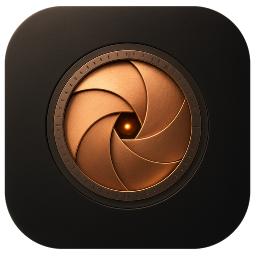

<p align="center">
  
</p>

<h1 align="center">InstaVault</h1>

<p align="center">
  <strong>Tu cuarto oscuro para Instagram.</strong><br/>
  Perfiles, publicaciones, reels, stories y highlights en máxima calidad,<br/>guardados en tu equipo y bajo tu control.
</p>

<p align="center">
  
  
  
  
  
  
</p>

---

## Qué hace

- **Archivo de perfiles**: busca un `@usuario` y guarda su perfil, foto, contadores y primeras publicaciones. Favoritos, filtros, orden y vista en lista o en “fotogramas”.
- **Sincronización por lotes** con reanudación: posts (fotos, videos, carruseles), stories activas y highlights.
- **Descarga por enlace**, como en los sitios web: pega una publicación, reel, carrusel, story o highlight, elige las piezas y guárdalas en el archivo o directamente en una carpeta.
- **Revelado en máxima calidad**: elige siempre el mejor candidato (resolución → bitrate → tamaño) y marca si la calidad está verificada.
- **Visor** a pantalla completa con luz ambiental, zoom, reproductor propio, carruseles, filmstrip, modo proyección e información técnica (dimensiones, bitrate, SHA-256…).
- **Cola de descargas** con concurrencia configurable, progreso en vivo, reintentos y re-resolución automática de enlaces caducados.
- **Importación de InstaVault 1.x**: trae perfiles, piezas, favoritos y archivos de la versión Tauri sin tocar la base original.
- **Actualizaciones automáticas** desde GitHub Releases.

## Cómo accede a Instagram

| | Modo anónimo | Con tu cuenta |
|---|---|---|
| Perfil público y primeras publicaciones | ✅ | ✅ |
| Publicación, reel o carrusel por enlace | ✅ | ✅ |
| Paginación profunda de un perfil | hasta que Instagram corte | ✅ |
| Stories y highlights | — | ✅ |
| Perfiles privados que sigues | — | ✅ |

- **Anónimo primero.** Las consultas públicas usan una partición de Chromium en memoria, sin sesión.
- **Tu cuenta como respaldo.** Si Instagram cierra el modo anónimo, la app pregunta (o lo hace sola, según *Ajustes → Cuando el modo anónimo se bloquea*) antes de usar tu cuenta.
- **Cada cuenta en su propia sesión aislada.** Inicias sesión en la ventana oficial de Instagram; la sesión vive en una partición persistente de Chromium y nunca se copia, exporta ni guarda en otro sitio. La app sólo comprueba que existe y lee el id numérico del usuario.
- **Los bytes vienen de la CDN** a través de una partición que nunca inicia sesión: la CDN no recibe cookies de ninguna cuenta.
- **Sin tráfico de fondo.** Abrir la app o la biblioteca no contacta Instagram; sólo tus acciones explícitas lo hacen, de una en una, con pausas y deteniéndose ante 401/403/429, checkpoints o `feedback_required`.

> Los sitios web que “ven todo sin iniciar sesión” lo consiguen con muchas cuentas y proxies en sus servidores. Una app de escritorio desde tu conexión no puede replicar eso; por eso stories, highlights y perfiles privados requieren tu cuenta.

## Instalación

Descarga el instalador `InstaVault-Setup-x.y.z.exe` desde [Releases](https://github.com/Xainner/instavault/releases).

> **Desde la 1.x (Tauri):** el sistema de actualizaciones cambió, así que la 2.0 se instala a mano una vez. Al abrirla te ofrece importar tu biblioteca anterior. A partir de ahí las actualizaciones son automáticas.

## Desarrollo

Requisitos: Node.js 22+ (Electron 44 trae su propio Node 24 con `node:sqlite`, sin módulos nativos).

```bash
npm install
npm run dev        # Electron + Vite con recarga en caliente
npm test           # Tests unitarios y de privacidad (vitest)
npm run build      # Typecheck + build de producción en out/
npm run dist       # Instalador NSIS en release/
```

Prueba visual de humo (biblioteca de demostración, sin tráfico a Instagram):

```bash
npm run build && xvfb-run -a npm run e2e   # capturas en e2e/.artifacts/
```

## Arquitectura

```
src/
├── main/                     Proceso principal (Node)
│   ├── index.ts              Ventana, protocolo, ciclo de vida
│   ├── ipc.ts                API IPC tipada y validada con zod
│   ├── db/                   SQLite (sólo metadatos) y migraciones
│   ├── vault/                Almacén por SHA-256 + protocolo vault:// con Range
│   ├── ig/
│   │   ├── bridge.ts         Ventana oculta por partición: fetch same-origin y captura CDP interna
│   │   ├── service.ts        Búsquedas, sincronización, enlaces y re-resolución
│   │   ├── parse.ts          Normaliza respuestas GraphQL, API v1, embed y DOM
│   │   ├── accounts.ts       Login en ventana oficial, una partición por cuenta
│   │   └── url.ts            Enlaces de Instagram y shortcode → id
│   ├── downloads/manager.ts  Cola, concurrencia, progreso, reintentos
│   ├── legacy/               Importador de InstaVault 1.x
│   └── updater.ts            electron-updater (GitHub Releases)
├── preload/                  contextBridge (sandbox + aislamiento de contexto)
├── shared/                   Contrato IPC y tipos
└── renderer/                 React 19 · Tailwind 4 · Motion · cmdk · Radix
```

**Datos** en `%APPDATA%/InstaVault/`: `library.db` (SQLite WAL) y `vault/` con los archivos nombrados por su SHA-256 (sin duplicados). “Guardar en el equipo” exporta copias con nombres legibles y verifica el hash.

## Comprobación manual en Windows

Este repositorio se prueba de forma automática sin red hacia Instagram. Antes de publicar, comprueba en Windows:

1. Buscar un perfil público → aparecen perfil, foto y primeras publicaciones.
2. Sincronizar → continuar hasta que Instagram limite; “Continuar con cuenta”.
3. Pegar enlaces de publicación, reel y carrusel en modo anónimo.
4. Conectar una cuenta → stories, highlights y un perfil privado que sigas.
5. Revelar pendientes, abrir el visor y guardar en el equipo.
6. Importar la biblioteca 1.x y verificar conteos.

## Aviso legal

InstaVault es una herramienta **personal y educativa** para archivar contenido al que ya tienes acceso. La descarga automatizada puede infringir los [Términos de uso de Instagram](https://help.instagram.com/581066165581870) y los derechos de autor de terceros: úsala con responsabilidad y respeta a los autores. Las ilustraciones de la interfaz se generaron con Rinari Visual Lab bajo licencia no comercial.

## Licencia

[MIT](LICENSE)
